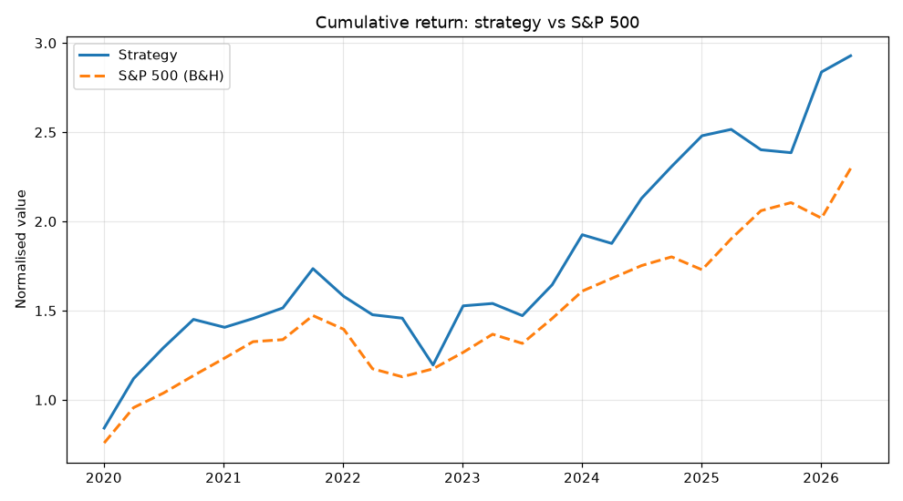
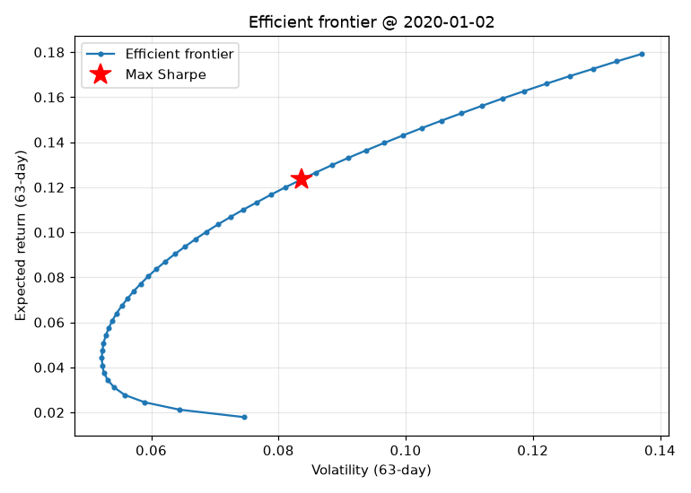
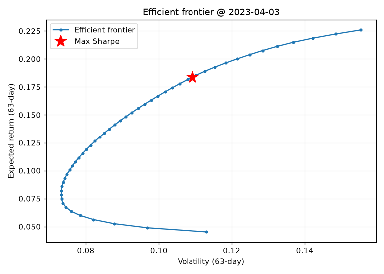
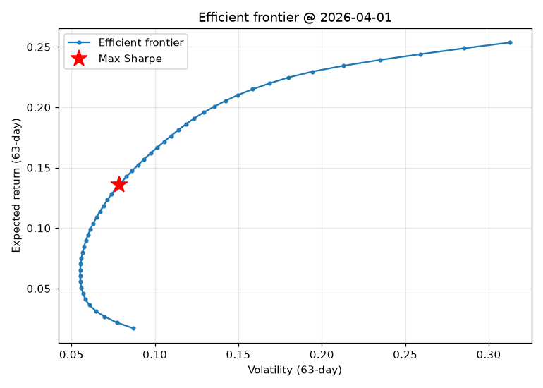
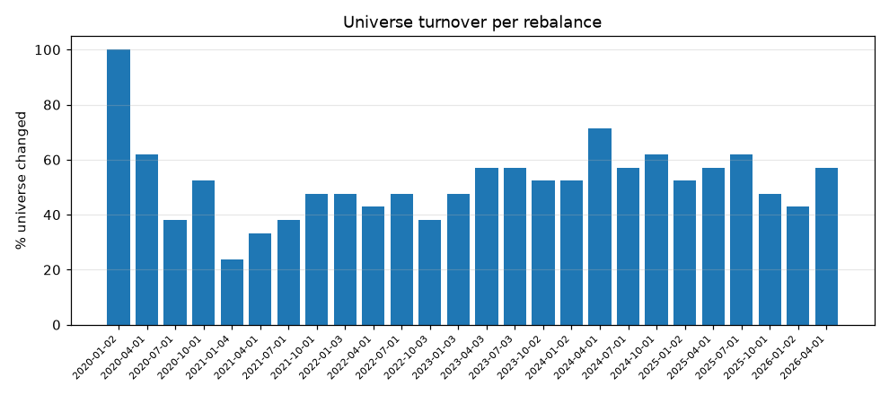

# ML-Driven Black-Litterman Portfolio — Backtest Report

## 1. Executive summary
Performance period **2020-01-01 → 2026-07-02**, quarterly rebalancing.
Strategy annualised return **18.71%** vs S&P 500
**13.65%**
(buy & hold) — outperforming by 5.06% annualised.
Strategy Sharpe 0.675 vs benchmark 0.568.

## 2. Cumulative return

## 3. Efficient frontier (representative dates)

## 4. Performance metrics

| Metric | Strategy | S&P 500 (B&H) |
|---|---|---|
| Annualized Return | 18.71% | 13.65% |
| Annualized Volatility | 24.45% | 19.66% |
| Sharpe Ratio | 0.675 | 0.568 |
| Max Drawdown | -31.12% | -23.31% |
| Calmar Ratio | 0.601 | 0.585 |
| VaR (95%) | -14.01% | -13.19% |
| CVaR (95%) | -16.81% | -20.01% |

## 5. ML quality diagnostics
- Mean Information Coefficient (rank corr, full universe): **-0.0051**
  (IC > 0.05 weakly predictive, > 0.1 good for cross-sectional equity — 08 §4.1)
- Mean directional accuracy: **54.98%** (50% = random)

IC and RMSE per sector are written to `tables/ic_by_sector.csv`.

## 6. Turnover & cost

Total transaction cost paid over the backtest:
**4.02%** of portfolio value (cumulative drag).

## 7. Limitations (explicit — 08 §7)
- **Survivorship bias**: current S&P 500 list applied retroactively (01 §5, 09 §1).
- **Rolling-window crisis coverage**: see `tables/crisis_coverage.csv` — the 10-year
  window "forgets" crises (2008 GFC, 2020 COVID) as they age out.
- **SVR hyperparameter tuning** tuned once on a sample, not per stock (03 §4, 09 §4).
- **Sector classification** held fixed for the whole backtest (01 §3.4, 09 §3).
- **Market-cap reconstruction** approximates shares as constant (01 §3.3, 09 §2).
- **Overlapping 63-day targets** → effective sample size << row count (03 §2).
